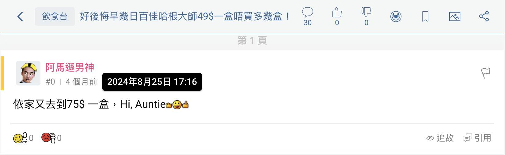
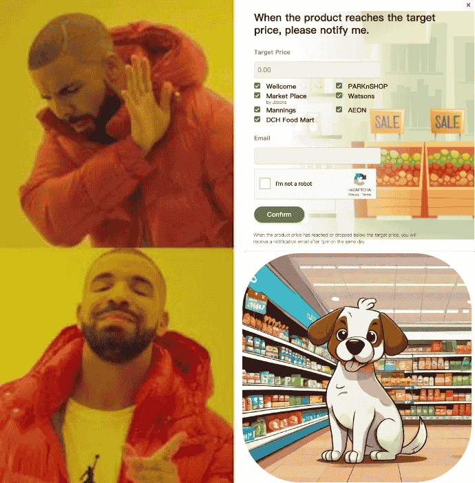
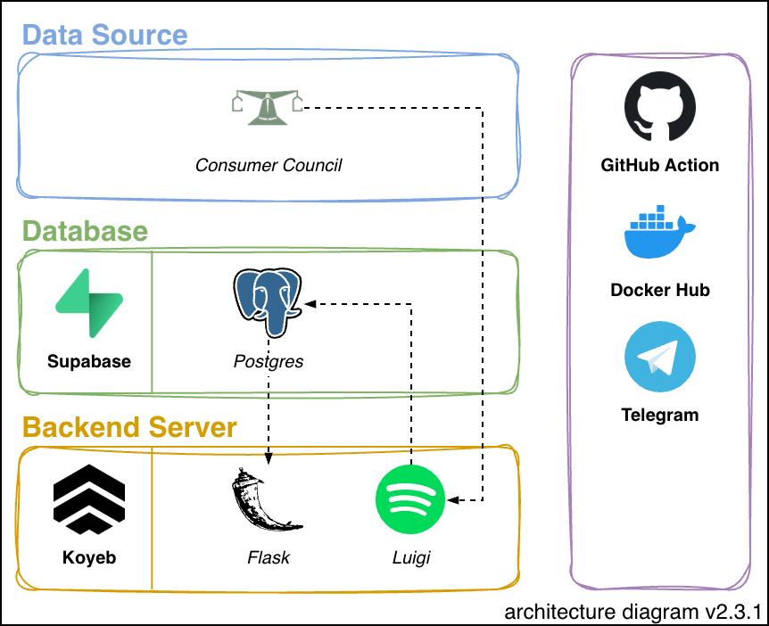

<!-- INTRODUCTION -->
# 🐶 SuperPriceWatchdog
In the current climate of rising costs, many consumers are feeling the pinch at the checkout. If you are a budget-conscious shopper who frequently visits supermarkets, this situation is likely all too familiar. Supermarkets often adjust their prices through promotions, utilising a pricing strategy known as [Hi-Lo Pricing](https://en.wikipedia.org/wiki/High%E2%80%93low_pricing).

Whilst it is possible to track these fluctuations manually, doing so can be both time-consuming and exhausting. To ease that burden, we built SuperPriceWatchdog, a tool designed to help you monitor supermarket prices more effectively.

  

  
  
  
<strong>First Published:</strong> 15 February 2024 <strong>Last Updated:</strong> 30 June 2026

<!-- ROADMAP -->
## Table of Contents
- [1 - Why We Built SuperPriceWatchdog](#1)
- [2 - When Should I Buy This Item?](#2)
    - [2.1 - Be Notified of Latest Deals](#2.1)
    - [2.2 - Price Alert Intelligence](#2.2)
- [3 - Behind the Scenes](#3)

<!-- SECTION 1 -->

## Why We Built SuperPriceWatchdog
SuperPriceWatchdog stands for **Super**market **Price** **Watchdog**. It is a Telegram bot designed to monitor fluctuating product prices across major supermarkets in Hong Kong. We created it to help users save time and effort when searching for the best available deals.

Users receive daily notifications, except on Fridays and Saturdays, about exceptional offers on their selected items. As mentioned above, SuperPriceWatchdog reduces the hassle of constant price monitoring, allowing users to direct their time and energy elsewhere.

  
  
<i>a poor Golden Son did not know how to play the game.</i>

<!-- SECTION 2 -->

## When Should I Buy This Item?
SuperPriceWatchdog offers several features to help you keep track of the items you care about. Setting up a daily price alert is the bot's main function. Let us look at how you can begin your journey towards better savings.

### Be Notified of Latest Deals
Simply send a message to [@SuperPriceWatchdog](https://t.me/SuperPriceWatchdogBot) on Telegram, and you will receive guidance on how to use the bot and set up your daily price alerts.

> [!NOTE]  
> Latency is expected for SuperPriceWatchdog relies on community servers and may need to wake a sleeping instance, which can add additional response time.

> [!WARNING]  
> Prices shown are not current. They are two days old.

> [!IMPORTANT]  
> No alerts will be sent when the API from DATA.GOV.HK does not function properly, such as when data for a specific date is missing. See [KNOWN_ISSUES](KNOWN_ISSUES.md) for details.

  

### Price Alert Intelligence
SuperPriceWatchdog collects 90 days of price records and calculates summary statistics for each item. When the standardised unit price, after promotion, is below one standard deviation from its mean, i.e. $Pr(Z \leq -1)$, that item is considered a particularly good deal. This price monitoring is fully automated and requires minimal effort. Unlike official price alerts, which require users to set a target price manually, this approach identifies attractive deals automatically.

Promotion weeks start on Fridays, so most prices are refreshed then, based on our past experience as a Red Label Supermarket employee. Unfortunately, the latest Online Price Watch (OPW) record reflects prices and promotions from two days earlier, which means the prices in our database may not reflect the latest prices. To avoid confusion, price alerts are disabled on Fridays and Saturdays.

  

<!-- SECTION 3 -->

## Behind the Scenes
SuperPriceWatchdog is built on top of the **Consumer Council**'s [OPW](https://data.gov.hk/en-data/dataset/cc-pricewatch-pricewatch) dataset, which provides supermarket item prices and promotions.

Each day, a data pipeline retrieves the data and stores it in a **PostgreSQL** database. The ETL process is orchestrated with _Luigi_ and uses _Polars_ together with **PostgreSQL** functions for data transformation and manipulation. At the end of the pipeline, a daily price alert is triggered and sent to users. Via webhooks, users interact with SuperPriceWatchdog on **Telegram**, with a **Flask** application processing their messages.

The web application is hosted on a **Koyeb** Hobby Plan account, while the database is maintained on **Supabase**'s free tier. These providers offer enough managed infrastructure to host and operate the service at no cost.

  

<!-- DISCLAIMER -->
---

**This was created as a personal hobby project and learning exercise.**
